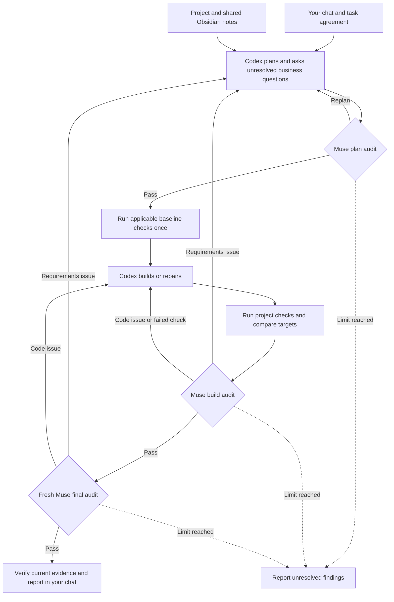

# Apex Workbench

Apex Workbench coordinates coding tasks from a terminal or an existing coding-agent session. It records the task scope, project rules, user decisions, checks, reviews, and repair rounds in the project.

Use the bundled engineering instructions or pin a different coding harness. The harness defines how the agent should work. Workbench records which instructions apply and checks the evidence required to finish.

- **CLI** to configure a project, start tasks, run checks, and compare past runs.
- **Existing agent session** to ask Codex or RubyMine Air to use the same workflow. [Use an existing session](#use-an-existing-codex-or-rubymine-session)

## How it works

The optional Codex and Muse workflow uses one chat for discovery, planning, implementation, and the final result. [Setup, commands and assessment replay](docs/AUDITED_WORKFLOW.md)



The manual workflow remains the default for existing configurations.

In the manual workflow, the CLI and your coding agent use the same checks. Each check or benchmark starts when you or the agent runs its command. Set `execution.max_repair_rounds` before starting the task. If checks still fail after the last allowed repair, Workbench stops the task when another repair round is requested.

### Proposed score target

A project could set a target such as **90/100** before the first run. Workbench would record the starting score, run the same benchmark after each repair, and keep the evidence for every round. It would finish when the score meets the target and every required correctness check and review passes. It would stop at the repair limit and report any unmet target. The project would supply the benchmark and score. The independent Appointment Flow benchmark would stay outside this loop.

The current release records the checks and repair rounds. It has no automatic score target or automatic retry on a low score.

| Part | Responsibility |
| --- | --- |
| [CLI entry point](bin/harness) | Starts the Ruby workflow and dispatches setup, task, and history commands. |
| [Task workflow](lib/workbench.rb) | Records decisions, validates the pinned instructions, and checks current evidence. |
| [Chat intake](chat_workflow.py) | Routes chat commands and collects decisions before Codex starts. |
| [Codex adapter](agent_adapter.py) | Starts or resumes the selected model session with its task scope. |
| [Engineering instructions](engine/ENGINE.md) | Define the coding, performance, and review rules used by the agent. |
| [Project benchmark guide](docs/BENCHMARKS.md) | Explains how to compare the same workload before and after a change. |

An installed project stores its task records under `.harness/tasks/<id>/`. Each check attempt keeps its result, standard output, and error output.

```text
project/
└── .harness/
    ├── bin/harness
    ├── project.json
    ├── engine/
    └── tasks/
        └── <id>/
            └── results/
                └── <check>/<phase>/<attempt>/
                    ├── result.json
                    ├── stdout.log
                    └── stderr.log
```

## Task decision tree

Follow the numbered steps in order. A number marks a user decision. Letters show the available answers. Chat asks one question at a time. The CLI can show all unanswered questions.

```text
harness
├── help
│   └── Show the fixed command list.
├── setup
│   ├── Install Workbench and select a coding harness.
│   └── Discover project commands and configure checks.
├── start a task
│   ├── audit     Inspect code and report findings.
│   ├── refactor  Improve the code while preserving behavior.
│   ├── feature   Add or change behavior within the agreed scope.
│   └── build     Build from the supplied requirements.
│       All modes continue through the same agreement below.
├── task agreement
│   ├── 1. Supply the action and scope. Confirm both.
│   │   ├── 1a. confirmed     Record the agreed scope.
│   │   └── 1b. Revise the scope before you confirm it.
│   ├── 2. Can the task change application code?
│   │   ├── 2a. deny          Inspect and report. Audit requires this answer.
│   │   └── 2b. allow_scoped  Change code in the agreed scope.
│   ├── 3. Can the task change the schema?
│   │   ├── 3a. deny          Keep migrations and schema files as they are.
│   │   └── 3b. allow         Allow app-owned schema work within scope.
│   ├── 4. Can the task change dependencies?
│   │   ├── 4a. deny          Keep manifests and lock files as they are.
│   │   └── 4b. allow         Allow dependency changes required by the task.
│   └── 5. Confirm the configured coding harness.
│       └── 5a. confirmed     Use the pinned instructions.
├── run the task
│   ├── Run the baseline checks.
│   │   └── Run the baseline benchmark if the project configured one.
│   ├── Send the agreed work to the agent or use the CLI task prompt.
│   ├── Run the final checks and repeat the configured benchmark.
│   └── Record the review for the current source.
│       ├── Pass → verify, report, and finish.
│       └── Finding → record a repair, fix it, and repeat the checks.
└── runs
    ├── list     Find active and past task IDs.
    ├── show     Open one task and its evidence.
    └── compare  Compare the checks and results for two task IDs.
```

Chat accepts the exact answer ID or the option label. `Revise the scope` means cancel the draft with `/cancel-setup` before you submit the scope, or stop the task and start again after Workbench creates it. Each new task needs its own decisions. After the first check, the task permissions are fixed. Workbench records a benchmark when you configure one for your project.

## Install in a project

Use Ruby 3.1 or later. The Windows release was tested with Ruby 3.4.10. Direct CLI use needs no Workbench server.

From the Workbench directory, install it into your project. Replace the example path with your project folder.

```powershell
ruby bin/harness setup init --project 'C:\src\inventory'
Set-Location -LiteralPath 'C:\src\inventory'
```

From the project root, define `harness` for the current PowerShell session. Repeat the function definition in each new terminal.

```powershell
function harness { ruby .harness/bin/harness @args }
harness help
harness setup discover --project .
```

The installer preserves existing project instructions. Review the commands found by discovery. Configure a real project check before starting work.

```powershell
Copy-Item .harness/project.json .harness/proposed.json
notepad .harness/proposed.json
```

Set the `checks` entry to use the actual command for your project. This example runs a Ruby test from the project root.

```json
"checks": [
  {
    "name": "stock_behavior",
    "argv": ["ruby", "test/stock_test.rb"],
    "cwd": ".",
    "required": true,
    "benchmark": false
  }
]
```

```powershell
harness setup configure --project . --file .harness/proposed.json
harness setup check-engine --project .
```

## Use an existing Codex or RubyMine session

Open your project in Codex or RubyMine Air. Give the agent your task in the regular chat. This path needs no Workbench server. [Project agent setup](docs/AGENT_ADAPTER.md#use-another-project-agent)

> Use Workbench to audit the inventory total in `stock.rb` and its callers. Read `.harness/docs/WORKFLOW.md`. Ask me for any missing task decisions.

| Stage | What you do | What the agent does |
| --- | --- | --- |
| Agree on the task | Describe the work and answer any remaining scope or permission questions. | Start the task, record your answers, and read the task instructions. |
| Run the task | Answer questions if the scope or permissions need to change. | Run the baseline checks, do the agreed work, and run the final checks. |
| Finish | Read the result. | Record the review and its evidence. Report what passed and what remains open. Finish only when the required checks pass. |

[Optional Workbench chat setup](docs/AGENT_ADAPTER.md#start-a-task-through-chat) explains how to start a separate Workbench-managed session.

## Use the CLI directly

Choose the mode that matches the request.

| Mode | Task boundary |
| --- | --- |
| `audit` | Inspect the agreed code and report findings. |
| `refactor` | Change the implementation and preserve caller-visible behavior. |
| `feature` | Implement the agreed change in behavior. |
| `build` | Build from the requirements you provide. |

Use this path when you want to start a task from PowerShell. These commands start a read-only audit and list the decisions Workbench needs.

```powershell
harness audit --project . --action "Review the inventory total" --scope "stock.rb and its callers"
harness internal questions --project .
```

Record the decisions before you run the checks. `harness task prompt --project .` prints the task instructions for the agent. The manual walkthrough shows how to record the answers, run checks before and after the work, save the agent's review, and finish the task. [Manual CLI walkthrough](docs/WORKFLOW.md#agree-on-the-task)

## Read evidence from past runs

```powershell
harness runs list --project .
harness runs show FIRST_ID --project .
harness runs compare FIRST_ID SECOND_ID --project .
```

Compare runs with the same workload and checks. A source change invalidates earlier final evidence for that task. A failed required check keeps the task incomplete.

The Windows 0.2.1 release passed 44 Ruby tests and 20 Python tests. A live Codex agent recorded one finding, repaired the code, and repeated the checks. The host reopened the review, checks, and completion record from the extracted installation. [Validation record](VALIDATION.md)
