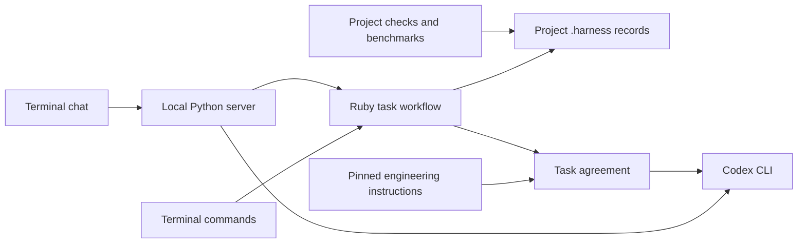

# Apex Workbench

Apex Workbench coordinates coding tasks from a terminal or a Codex chat. It records the task scope, project rules, user decisions, checks, reviews, and repair rounds in the project.

Use the bundled engineering instructions or pin a different coding harness. The harness defines how the agent should work. Workbench records which instructions apply and checks the evidence required to finish.

- **CLI** to configure a project, start tasks, run checks, and compare past runs.
- **Chat** to agree on a task, answer questions, and work with Codex in the same session.

## How it works



| Part | Responsibility |
| --- | --- |
| [CLI entry point](bin/harness) | Starts the Ruby workflow and dispatches setup, task, and history commands. |
| [Task workflow](lib/workbench.rb) | Records decisions, validates the pinned instructions, and checks current evidence. |
| [Chat intake](chat_workflow.py) | Routes chat commands and collects decisions before Codex starts. |
| [Codex adapter](agent_adapter.py) | Starts or resumes the selected model session with its task scope. |
| [Engineering instructions](engine/ENGINE.md) | Define the coding, performance, and review rules used by the agent. |
| [Project benchmark guide](docs/BENCHMARKS.md) | Explains how to compare the same workload before and after a change. |

An installed project stores its task records under `.harness/tasks/<id>/`. Each check attempt keeps its result, standard output, and error output.

```text
project/
└── .harness/
    ├── bin/harness
    ├── project.json
    ├── engine/
    └── tasks/
        └── <id>/
            └── results/
                └── <check>/<phase>/<attempt>/
                    ├── result.json
                    ├── stdout.log
                    └── stderr.log
```

## Task decision tree

Follow the numbered steps in order. A number marks a user decision. Letters show the available answers. Chat asks one question at a time. The CLI can show all unanswered questions.

```text
harness
├── help
│   └── Show the fixed command list.
├── setup
│   ├── Install Workbench and select a coding harness.
│   └── Discover project commands and configure checks.
├── start a task
│   ├── audit     Inspect code and report findings.
│   ├── refactor  Improve the code while preserving behavior.
│   ├── feature   Add or change behavior within the agreed scope.
│   └── build     Build from the supplied requirements.
│       All modes continue through the same agreement below.
├── task agreement
│   ├── 1. Supply the action and scope. Confirm both.
│   │   ├── 1a. confirmed     Record the agreed scope.
│   │   └── 1b. Revise the scope before you confirm it.
│   ├── 2. Can the task change application code?
│   │   ├── 2a. deny          Inspect and report. Audit requires this answer.
│   │   └── 2b. allow_scoped  Change code in the agreed scope.
│   ├── 3. Can the task change the schema?
│   │   ├── 3a. deny          Keep migrations and schema files as they are.
│   │   └── 3b. allow         Allow app-owned schema work within scope.
│   ├── 4. Can the task change dependencies?
│   │   ├── 4a. deny          Keep manifests and lock files as they are.
│   │   └── 4b. allow         Allow dependency changes required by the task.
│   └── 5. Confirm the configured coding harness.
│       └── 5a. confirmed     Use the pinned instructions.
├── run the task
│   ├── Run the baseline checks.
│   │   └── Run the baseline benchmark if the project configured one.
│   ├── Send the agreed work to the agent or use the CLI task prompt.
│   ├── Run the final checks and repeat the configured benchmark.
│   └── Record the review for the current source.
│       ├── Pass → verify, report, and finish.
│       └── Finding → record a repair, fix it, and repeat the checks.
└── runs
    ├── list     Find active and past task IDs.
    ├── show     Open one task and its evidence.
    └── compare  Compare the checks and results for two task IDs.
```

Chat accepts the exact answer ID or the option label. `Revise the scope` means cancel the draft with `/cancel-setup` before you submit the scope, or stop the task and start again after Workbench creates it. Each new task needs its own decisions. After the first check, the task permissions are fixed. Workbench records a benchmark when you configure one for your project.

## Install in a project

The Windows release was tested with Ruby 3.4.10 and Python 3.11.15. Use Ruby 3.1 or later. Chat also needs Python and a signed-in Codex CLI. Use the CLI workflow without a chat server to run checks and review records.

From the Workbench directory, install it into your project. Replace the example path with your project folder.

```powershell
ruby bin/harness setup init --project 'C:\src\inventory'
Set-Location -LiteralPath 'C:\src\inventory'
```

From the project root, define `harness` for the current PowerShell session. Repeat the function definition in each new terminal.

```powershell
function harness { ruby .harness/bin/harness @args }
harness help
harness setup discover --project .
```

The installer preserves existing project instructions. Review the commands found by discovery. Configure a real project check before starting work.

```powershell
Copy-Item .harness/project.json .harness/proposed.json
notepad .harness/proposed.json
```

Set the `checks` entry to use the actual command for your project. This example runs a Ruby test from the project root.

```json
"checks": [
  {
    "name": "stock_behavior",
    "argv": ["ruby", "test/stock_test.rb"],
    "cwd": ".",
    "required": true,
    "benchmark": false
  }
]
```

```powershell
harness setup configure --project . --file .harness/proposed.json
harness setup check-engine --project .
```

## Use chat

Start the local server in one terminal. The command is named `ui`. The server also handles terminal chat, so a browser is optional.

```powershell
harness ui --project . --port 8792
```

In a second terminal, open the project directory and define `harness` as shown above. Send a task mode and action.

```powershell
harness chat --project . --message "/help"
harness chat --project . --message "refactor Simplify the inventory total"
```

Send the affected scope when chat asks for it. Reply with a listed option for each question. Suggested answers grant no permission. To record an existing restriction, cite its exact text and source.

For example, reply to the scope question with `stock.rb and its callers`. Then send these answers in order. This example allows changes to the agreed code and keeps the schema and dependencies fixed.

```powershell
harness chat --project . --message "stock.rb and its callers"
harness chat --project . --message "confirmed"
harness chat --project . --message "allow_scoped"
harness chat --project . --message "deny"
harness chat --project . --message "deny"
harness chat --project . --message "confirmed"
```

After the agreement is complete, ordinary messages go to the configured Codex agent. The installed default is Astra 6.2 High. Use the same chat endpoint to continue the task.

| Chat command | Use it to |
| --- | --- |
| `/status` or `/runs` | Read the active task or list past task IDs. |
| `/check stock_behavior baseline` | Run the configured check before editing. |
| `/benchmark baseline` | Run the configured benchmark before editing. |
| `/check stock_behavior after` | Repeat the check on the current source. |
| `/repair REASON` | Record a verified finding before a repair. |
| `/verify`, `/report`, or `/finish` | Verify evidence, read the report, or finish the task. |
| `/pause REASON`, `/resume ID`, or `/stop REASON` | Control the current task. |

Pass each command as a `--message`. Replace `stock_behavior` with your check name. Use `/benchmark after` to repeat the same benchmark after a change. [Chat setup and model access](docs/AGENT_ADAPTER.md)

## Use the CLI directly

Choose the mode that matches the request.

| Mode | Task boundary |
| --- | --- |
| `audit` | Inspect the agreed code and report findings. |
| `refactor` | Change the implementation and preserve caller-visible behavior. |
| `feature` | Implement the agreed change in behavior. |
| `build` | Build from the requirements you provide. |

For a read-only audit, start the task and inspect the questions.

```powershell
harness audit --project . --action "Review the inventory total" --scope "stock.rb and its callers"
harness internal questions --project .
harness internal answer scope_confirmed confirmed --project .
harness internal answer code_changes deny --project .
harness internal answer migrations deny --project .
harness internal answer dependencies deny --project .
harness internal answer engine_integration confirmed --project .
harness task prompt --project .
```

Confirm the engine choice after you check the configured instructions. Run the baseline and final checks. Record a review tied to the current source.

```powershell
harness internal run stock_behavior --phase baseline --project .
harness internal run stock_behavior --phase after --project .
Copy-Item .harness/templates/REVIEW.json .harness/review.json
notepad .harness/review.json
harness internal review --project . --file .harness/review.json
harness task verify --project .
harness task report --project .
harness task finish --project .
```

Enter the current source fingerprint in the review. Give each criterion a verdict and evidence. The workflow guide also explains how to pin your own harness and configure a benchmark. [Task workflow](docs/WORKFLOW.md)

## Read evidence from past runs

```powershell
harness runs list --project .
harness runs show FIRST_ID --project .
harness runs compare FIRST_ID SECOND_ID --project .
```

Compare runs with the same workload and checks. A source change invalidates earlier final evidence for that task. A failed required check keeps the task incomplete.

The Windows 0.2.1 release passed 44 Ruby tests and 20 Python tests. A live Codex agent recorded one finding, repaired the code, and repeated the checks. The host reopened the review, checks, and completion record from the extracted installation. [Validation record](VALIDATION.md)
